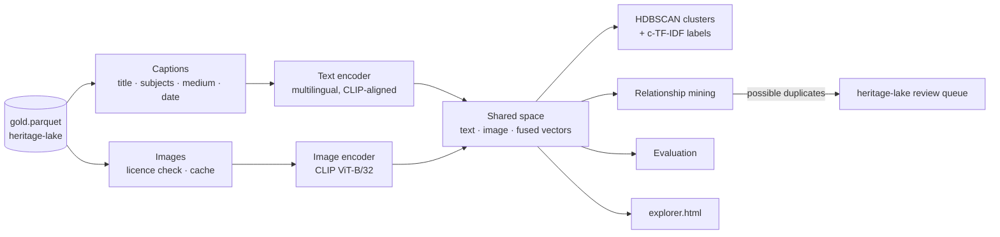

# heritage-atlas

A **multimodal embedding space** (images + multilingual text) over an integrated cultural-heritage dataset, used to uncover clusters, hidden duplicates, wrongly attached images and visual relationships between works that no catalogue links.

Stage 3 of a three-repo pipeline:

| Stage | Repo | What it does |
|---|---|---|
| 1. Harvest | [heritage-harvest](https://github.com/jaogye/heritage-harvest) | Scrape and collect raw records, with provenance |
| 2. Integrate | [heritage-lake](https://github.com/jaogye/heritage-lake) | Clean, resolve entities, merge with in-house data, quality-gate |
| **3. Embed** | **heritage-atlas** (this repo) | Multimodal embedding space, clusters, relationships |



## Quick start

```bash
pip install -e ".[dev,models]"          # models: torch, open_clip, sentence-transformers
atlas build --gold ../heritage-lake/data/lake/gold.parquet --embedder clip-multilingual
atlas search "a crowded winter village seen from above"
atlas similar <entity_id> --view image
open data/atlas/explorer.html

# no GPU, no downloads: smoke-run the whole pipeline with a hashing embedder
atlas build --embedder hash --no-images
pytest                                   # 18 tests, no model downloads
```

## Design

**Why CLIP plus a multilingual text student.** Belgian heritage metadata is Dutch, French and English. Plain CLIP reads English only, so "De val van de opstandige engelen" would land far from its own image. `clip-ViT-B-32-multilingual-v1` was distilled to place 50+ languages into the same space as CLIP ViT-B/32's text tower, so captions in any of the three languages, the English title and the image itself end up near each other. Both models are behind one small `Embedder` interface; swapping in SigLIP or a domain-tuned model is a one-class change.

**Captions are written for the encoder, not for people.** CLIP sees at most 77 tokens, so captions lead with what is visible (title, alternative titles, type, creator, date, subjects, medium). Institution and city are left out on purpose: they would cluster works by where they hang instead of by what they show. They remain available as facets.

**Three vectors per object, not one.** Every object keeps a text vector, an image vector (if it has a licensed image), and a fused vector (weighted mean in the shared space, falling back to text alone when there is no image). Keeping the modalities separate is what makes image-versus-metadata checks possible, and `--image-weight` lets the balance be tuned against the evaluation below.

**Licences are checked before any image is downloaded.** Only openly licensed images (Public Domain Mark, CC0, CC BY, Wikimedia Commons) or images the research team marked as cleared in its own catalogue are fetched. Images are cached, resized and failures are recorded rather than fatal.

## What the space is used for

| Output | What it finds | Why it matters |
|---|---|---|
| **clusters** (`clusters.json`) | HDBSCAN groups, labelled with class-based TF-IDF keywords and described by creators, centuries and institutions | A map of the collection's visual and thematic structure, not its catalogue structure |
| **possible-duplicate** | Entities that are almost certainly one object | Written to `duplicate_candidates.csv` in heritage-lake's review format: the space catches merges that metadata could not (different-language titles, no shared inventory number) |
| **image-text-mismatch** | Objects whose image is far from their own caption relative to the collection (z-score) | Usually a wrong image attached upstream; a data-quality signal metadata checks cannot produce |
| **visual-echo** | Strong image similarity across different artists or decades apart | Candidate copies, workshop versions, shared models, influence. Leads for researchers, not conclusions |
| **thematic-bridge** | Close neighbours held by different institutions | Connections across collections that no catalogue records |

Every relationship row carries its evidence (cosines, artists, year gap), so a researcher can judge it.

## Evaluation

`evaluation.json` reports, for whichever model was used:

* **cross-modal recall@k**: query with an object's caption, is its own image in the top k? This checks whether text and images are actually aligned for this domain before anyone trusts a cross-modal search.
* **facet neighbourhood purity@5** for the fused, text and image views: how often an object's nearest neighbours share its creator, object type or century. It shows what each view has learned to care about and gives an objective way to choose `--image-weight`.
* **silhouette** of the clusters and the noise fraction.

The test suite runs the full pipeline on a synthetic collection with known structure (colour groups, a planted duplicate, a planted wrong image, a planted visual echo) and asserts that each one is found.

> **Results with real models.** This sandbox could not download model weights or images, so the numbers in this repo come from the synthetic tests. Run `atlas build --embedder clip-multilingual` on a heritage-lake output and commit `evaluation.json` and a screenshot of `explorer.html` to `docs/` to show real results.

## Project layout

```
src/atlas/
  embedders.py   Embedder interface: OpenCLIP (+ multilingual text student), hashing stand-in
  documents.py   gold rows -> captions, licence check
  images.py      polite, cached, licence-aware image fetching
  space.py       text / image / fused vectors, kNN, cross-modal search, save/load
  analysis.py    clustering, cluster labelling, relationship mining
  evaluate.py    cross-modal recall, facet purity, silhouette
  build.py       end-to-end build and outputs
  explorer_template.html   self-contained interactive map (no external scripts)
  cli.py         atlas build | search | similar
data/sample/gold.parquet   output of heritage-lake on its synthetic sample
```

Scale notes: kNN is exact and blocked (fine to a few hundred thousand objects on CPU); above that, `faiss-cpu` from the `extras` group is the drop-in. `umap-learn` is used for the 2-D map when installed, PCA otherwise.

## Working with agentic coding tools

`CLAUDE.md` holds the rules an AI coding assistant follows here (no model downloads in tests, every relationship type needs a planted case in the synthetic collection, licence checks are never bypassed by default), and `.claude/commands/add-relationship.md` is the reusable task for adding a new kind of relationship.

## License

MIT
